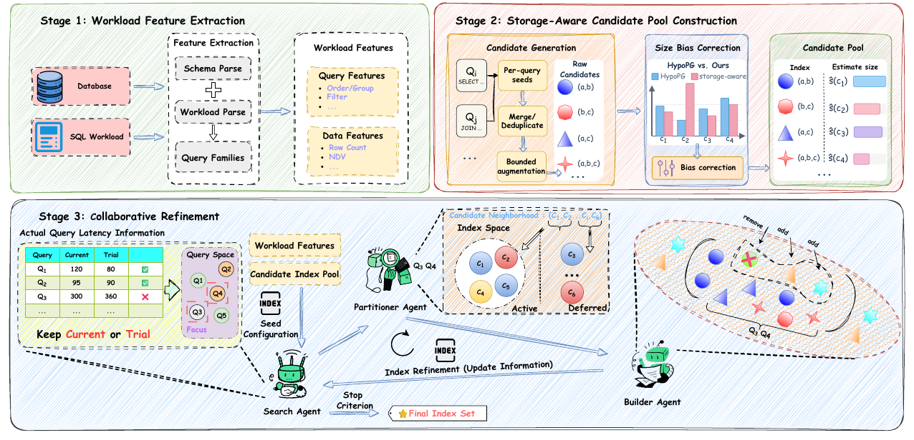

# CRAFR

We propose CRAFR, an index advisor that selects a storage-bounded index configuration with a large language model and real PostgreSQL feedback.



## Environment Preparation

Our proposed method is implemented with the following environments:

- PostgreSQL : version 14.
- HypoPG extension for virtual index management.
- Python Environment : Anaconda3, Python version 3.9.

Step 1 : Download and install PostgreSQL 14.

```
sudo apt-get update
sudo apt-get install postgresql postgresql-client
```

Step 2 : Install the HypoPG extension according to https://github.com/HypoPG/hypopg.

Step 3 : Create the virtual environment with Python = 3.9 and activate it.

```
conda create -n crafr python=3.9
conda activate crafr
```

Step 4 : Install the required packages.

```
pip install psycopg2-binary sqlparse sql-metadata openai
```

## Supported Benchmarks

Owing to the characteristics of large language models, CRAFR can theoretically support various workload compositions and database schemas. Based on the experimental attempts, we use OLAP workloads where all SQL statements can be obtained, and take the ``workload.sql`` file path as input information.

- SSB (refer to https://github.com/lemire/StarSchemaBenchmark)
- TPC-H (refer to https://github.com/gregrahn/tpch-kit)
- TPC-DS (refer to https://github.com/gregrahn/tpcds-kit)
- DSB (refer to https://github.com/microsoft/dsb)
- JOB (refer to https://github.com/gregrahn/join-order-benchmark)

## Using CRAFR

1. Modify the relevant configuration `config.json`.

   ```
   {
       "workload": {
           "workload_file": "../test/{dbname}_test.sql",
           "output_file": "./feature/{dbname}_workload_features.json"
       },
       "database": {
           "host": "/path/to/postgresql/run",
           "port": 5432,
           "user": "postgres",
           "password": "",
           "dbname": "TPCDS"
       },
       "index_selector": {
           "index_storage_proportion": 0.6,
           "workload_summary": "./feature/{dbname}_workload_summary.txt",
           "candidate_file": "./candidate/{dbname}_candidate_indexes.json"
       },
       "index_combination": {
           "result_file": "./results/{dbname}_index_combination.json",
           "max_iterations": 3,
           "max_llm_calls": 16,
           "local_candidate_limit": 12,
           "total_tuning_time_seconds": 0,
           "statement_timeout_seconds": 600,
           "max_physical_trials": 3,
           "max_additions": 2,
           "max_removals": 2
       },
       "llm": {
           "api_key": "xxxx",
           "base_url": "xxxxx",
           "model": "gpt-4.1"
       }
   }
   ```

2. Run CRAFR from this directory. `all` runs Stage 1, Stage 2, Stage 3, then the timing: one discarded warm-up, one baseline, build the final indexes, and measure their latency.

   ```
   cd CRAFR
   python -m core.main all
   ```
